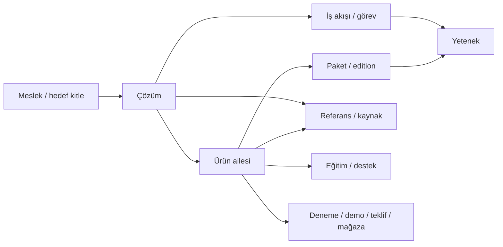

# ALLPLAN bilgi mimarisi referans analizi

Tarih: 19.10.2026 (Europe/Istanbul). Durum: bağımsız referans araştırması; Aluplan karşılaştırması ve uygulama kararı henüz yapılmadı.

## 1. Kapsam ve yöntem

International İngilizce görünüm esas alındı. Kök alan adı web araştırma istemcisinde ABD görünümüne yönlendi; International seçicisinin `/index.php?id=13001` hedefi ayrıca incelendi. Bu hedefin canonical'ı `https://www.allplan.com/`. ABD görünümü yalnız bölgesel farkı anlamak için kullanıldı. Bölgesel menü, ürün, fiyat ve CTA'lar birbirine karıştırılmamalı.

Dokuz International sayfanın herkese açık HTML'si GET ile incelendi; başlıklar, bağlantılar, canonical, JSON-LD ve microdata işaretleri kontrol edildi. İlk altı sayfada RDFa `typeof` ve hreflang sayıları da tarandı. Form gönderilmedi, oturum açılmadı, alışveriş yapılmadı. Etkileşimli kullanıcı testi veya tam site crawl'ı yapılmadı. Aşağıdaki yollar gözlemlenen bağlantı dizileridir; dönüşüm oranı veya tamamlanmış müşteri yolculuğu kanıtı değildir.

**Gözlem** canlı HTML/bağlantıyla desteklenen bilgiyi; **yorum** bu gözlemden çıkarılan mimari değerlendirmeyi; **aday** sonraki Aluplan PRD'sinde tartışılacak öneriyi belirtir. Dahili TYPO3 veritabanı, içerik türleri ve editör ekranları bilinmiyor.

## 2. Ana navigasyonun mantığı

**Gözlem:** International ana menü beş giriş sunuyor: Solutions, Products, Training & Services, Resources, Company & Career. Çözüm tarafı bina tasarımı, altyapı tasarımı, inşaat planlaması ve işbirliği çevresinde gruplanıyor. Mimarlık, yapı mühendisliği, MEP, yol, köprü, prekast, çelik ve şantiye gibi alt girişler var. Ürün tarafında yazılım aileleri, paket karşılaştırması ve partner çözümleri ayrı erişimler oluşturuyor. Eğitim/destek ve müşteri/öğrenci portalları ayrıca görünür. Kaynak: [International ana sayfa](https://www.allplan.com/index.php?id=13001).

**Yorum:** Aynı portföye iki giriş modeli var: “hangi işi yapıyorum?” ve “hangi ürünü arıyorum?”. Bunlara satın alma sonrası hizmet ve bilgi edinme yolları ekleniyor. Ürün kataloğunu tek başına ana navigasyon yapmak yerine kullanıcı niyetiyle sınıflandırma uygulanmış. Bu, menünün arkasında tek bir klasör ağacından daha zengin içerik ilişkileri gerektirir; gerçek CMS şeması hakkında kanıt değildir.

**Bölgesel gözlem:** ABD ana sayfasında demo çağrıları ve ürün giriş/destek bağlantısı belirgin; International üst navigasyonda ücretsiz deneme bulunuyor. ABD portföyünde MANUFACTON ve Steel Genie gibi farklı girişler görülüyor. Kaynak: [ABD görünümü](https://www.allplan.com/us_en). Bu nedenle bir ülkenin katalog veya CTA önceliği Türkiye için otomatik karar değildir.

## 3. Ürün, paket ve çözüm ayrımı

| Katman | Kullanıcının sorusu | Gözlenen örnek ve kanıt |
|---|---|---|
| Çözüm / disiplin | Benim işimde neyi çözüyor? | [Architecture](https://www.allplan.com/industry-solutions/architecture-software/) |
| İş akışı | Hangi aşamada hangi işi yapacağım? | Mimarlık sayfasında konsept, geliştirme, detay ve uygulama aşamaları |
| Ürün | Hangi yazılım bunu sağlıyor? | [ALLPLAN Civil](https://www.allplan.com/products/allplan-civil/), [ALLPLAN Precast](https://www.allplan.com/products/allplan-precast/) |
| Paket / edition | Hangi kapsamı satın almalıyım? | [Paket karşılaştırma](https://www.allplan.com/package-overview/) |
| Ekosistem / entegrasyon | Ek ihtiyacımı ne tamamlıyor? | [Partner çözümleri](https://www.allplan.com/allplan-partner-solutions/) |
| Hizmet | Kullanımda nasıl destek alırım? | [Teknik destek](https://www.allplan.com/help/technical-support/) |

**Gözlem:** Paket sayfasında Basic → Concept → Professional → Ultimate artan kapsamla anlatılıyor; sonraki paketin öncekinin özelliklerini içerdiği açıkça belirtiliyor. Civil ve Precast, uzmanlaşmış ürünler bölümünde ayrıca karşılaştırma bağlantılarına sahip. Kararsız kullanıcı için iletişim yolu; sistem gereksinimi ve eğitim bağlantıları da var. Fiyatlar bölgesel ve zamana bağlı olduğundan Türkiye fiyatı olarak kaydedilmedi. Kaynak: [Paket karşılaştırma](https://www.allplan.com/package-overview/).

**Yorum:** Ürün ailesi, edition, özellik ve meslek birbirinin yerine kullanılmıyor. Yine de Civil gibi uzmanlaşmış ürünlerin paket içerikleriyle ilişkisi ayrıca açıklanıyor. Gelecekteki veri modelinde bu kavramları tek bir `category` alanına sıkıştırmak belirsizlik yaratabilir.

## 4. Sayfa sunum desenleri

### Çözüm örneği: mimarlık

**Gözlem:** Mesleğe yönelik giriş ve deneme/iş akışı CTA'sını, ihtiyaç açıklaması, faydalar, sorunlar ve yetenekler izliyor. İş akışı dört tasarım aşamasına bölünüyor; aşamalarda görev açıklamaları ve videolar bulunuyor. Kaynak: [Mimarlık çözümü](https://www.allplan.com/industry-solutions/architecture-software/).

**Yorum:** Özellik listesinden önce iş bağlamı kuruluyor. Kullanıcı kendi göreviyle ürün yeteneğini ilişkilendirebiliyor. Uzun sayfa ve geniş görev listesi keşif için yararlı olabilir; okunabilirlik ve tamamlama başarısı kullanıcı testi yapılmadan kesinleştirilemez. Sayfadaki performans yüzdeleri üretici iddiasıdır, Aluplan içeriğine aktarılacak doğrulanmış sonuçlar değildir.

### Çözüm örneği: prekast

**Gözlem:** Üretim sürecinin sorunları ve otomasyon faydaları anlatılıyor; ardından deneme, Ultimate ve Precast teklifleri geliyor. Müşteri görüşleri de kullanılıyor. Kaynak: [Prekast çözümü](https://www.allplan.com/industry-solutions/precast-design-planning-software/).

**Yorum:** Bir çözüm sayfasının tek ürünle sınırlı olması gerekmiyor. Aynı ihtiyaca farklı paket/ürün seçenekleri bağlanabiliyor. Bu bağlantının doğru seçim yaptırdığına ilişkin analitik veri yok.

### Ürün örneği: Civil

**Gözlem:** Ürünün tanımı, kapsadığı yetenekler, ilgili köprü/inşaat iş akışları, kullanıcı sorunları, faydalar, özellikler, bulut hizmetleri, ek seçenekler, FAQ, referans projeler ve satın alma/deneme yolları bulunuyor. Ultimate kapsamıyla ilişki açıkça anlatılıyor. Kaynak: [Civil](https://www.allplan.com/products/allplan-civil/).

**Yorum:** Ürün sayfası katalog kaydı olmanın yanında değerlendirme merkezi işlevi görüyor. “Ne içeriyor?”, “işime nasıl uyuyor?” ve “nasıl ilerlerim?” soruları aynı bağlamda cevaplanıyor.

### Ürün örneği: Precast

**Gözlem:** Ürün tanımı ve sorunlar; özellikler, tanıtım içerikleri, müşteri görüşleri, projeler, teklifler, ilgili kaynaklar ve FAQ ile destekleniyor. Kaynak: [Precast](https://www.allplan.com/products/allplan-precast/).

**Sınırlı teknik gözlem:** İlk HTML'de ana ürün ifadesi H2, FAQ ise H1 olarak görüldü. Bu örnek, büyük bir sitenin başlık düzeninin otomatik olarak kopyalanacak kusursuz bir standart olmadığını gösterir; tek başına SEO kaybını kanıtlamaz.

### Ekosistem

**Gözlem:** Partner sayfasında farklı görevleri karşılayan eklentiler/entegrasyonlar ile partner olma süreci, BIMPLUS ve Python API bölümleri bir arada. Kaynak: [Partner çözümleri](https://www.allplan.com/allplan-partner-solutions/).

**Yorum:** Ekosistem ürünün erişemediği kullanım senaryolarını genişletiyor. Ancak katalog arayan kişiyle partner başvurusu yapan kişinin niyeti farklı; Aluplan için bu ikisini birleştirmek zorunlu değildir.

## 5. Gözlemlenen kullanıcı yolları

| Niyet | Gözlemlenen bağlantı yolu | İnceleme sınırı |
|---|---|---|
| Mesleğim için çözüm arıyorum | Ana sayfa/menü → Architecture → iş akışı veya Free Trial | Görev içerikleri ve CTA hedefi incelendi; video izleme testi yapılmadı |
| Paket seçiyorum | Products → Compare & Buy → edition More Info → mağaza | Mağaza bağlantıları görüldü; mağaza/ödeme akışı incelenmedi |
| Altyapı ürünü araştırıyorum | Products → Civil → ilgili iş akışı / View editions / Get offer | Ürün sayfası bağlantıları incelendi; teklif gönderilmedi |
| Önce denemek istiyorum | Free Trial → Trial Or Subscription → Download Now | Seçim sayfası incelendi; indirme/kayıt tamamlanmadı |
| Kurmadan incelemek istiyorum | Trial Or Subscription → interaktif ürün turu | Tur giriş bağlantısı görüldü; tur tamamlanmadı |
| Destek istiyorum | Training & Services → Technical Support → bölgesel satış ortağı | Bölgesel yönlendirme görüldü; partner erişimi sonuca kadar test edilmedi |
| Öğrenmek istiyorum | Technical Support → Learn Now / kayıtlı yayın / kılavuz / FAQ | Harici hedefler gözlemlendi; üyelik kapsamı doğrulanmadı |

Deneme sayfası üç farklı taahhüt düzeyini ayırıyor: 14 günlük ticari olmayan deneme, aylık ticari abonelik ve kurulum gerektirmeyen ürün turu. Bu gözlem mevcut Aluplan metnini değiştirme kararı değildir. Kaynak: [Deneme/abonelik](https://www.allplan.com/trial-or-subscription/).

Teknik destek sayfası bölgeye göre iletişim ve satış ortağı bağlantıları sunuyor; öğrenme kaynaklarına da geçiş veriyor. **Yorum:** Satış sonrası yardımın portföyden ayrı, sürekli erişilebilir olması değerli bir referanstır. Kaynak: [Teknik destek](https://www.allplan.com/help/technical-support/).

## 6. Schema incelemesi: üç ayrı anlam

### A. Yayınlanan Schema.org işaretlemesi — gözlem

Kontrol, curl ile alınan ilk HTML yanıtındaki `application/ld+json` scriptleri ve `itemtype` niteliklerini aradı. İlk altı örnekte `typeof` da kontrol edildi. Regex tabanlı kaynak kontrolüdür; Rich Results/Schema Validator veya JavaScript sonrası DOM testi değildir.

| Sayfa | JSON-LD blok | Microdata itemtype | RDFa typeof | Canonical / hreflang |
|---|---:|---:|---|---|
| International `/index.php?id=13001` | 0 | 0 | 0 | Canonical kök URL; 40 hreflang işareti |
| Mimarlık çözümü | 0 | 0 | 0 | Kendi URL'si; 38 hreflang işareti |
| Prekast çözümü | 0 | 0 | 0 | Kendi URL'si; 40 hreflang işareti |
| Paket karşılaştırma | 0 | 0 | 0 | Kendi URL'si; 40 hreflang işareti |
| Deneme/abonelik | 0 | 0 | 0 | Kendi URL'si; 17 hreflang işareti |
| Teknik destek | 0 | 0 | 0 | Kendi URL'si; 38 hreflang işareti |
| Civil ürünü | 0 | 0 | Kontrol edilmedi | Bu örnekte ayrıca sayılmadı |
| Precast ürünü | 0 | 0 | Kontrol edilmedi | Bu örnekte ayrıca sayılmadı |
| Partner çözümleri | 0 | 0 | Kontrol edilmedi | Bu örnekte ayrıca sayılmadı |

Kaynaklar yukarıdaki ilgili sayfa bağlantılarıdır. Sayılar 19.10.2026 yakalamasına aittir. Hreflang işareti sayısı benzersiz dil sayısı değildir; tekrarlar veya bölgesel varyantlar olabilir. Canonical/hreflang, Schema.org değildir. Görsel FAQ bölümü bulunması FAQPage JSON-LD bulunduğunu göstermez. Bu örneklemden “ALLPLAN genelinde schema yok” sonucu çıkarılamaz; mağaza, blog, diğer diller ve sonradan JS ile eklenen işaretleme kapsam dışıdır.

### B. İçerik ilişkileri — yorum

Görünen sunumu açıklayan kavramsal ilişki modeli aşağıdadır. ALLPLAN'ın gerçek veritabanı şeması değildir:

Buradaki oklar “ilişkili içerik” anlamında; bire-bir ilişki veya veritabanı foreign key iddiası değildir. Menü ağacı ile içerik ilişki ağı farklı şeylerdir.

### C. Google kurallarıyla doğrulama — 19.10.2026

Kullanılan skill: [schema / SKILL.md](skill://schema/SKILL.md), v2.0.0. Skill değerlendirme çerçevesi olarak kullanıldı; güncel Google belgeleriyle çelişen kısa tabloları aşağıda düzeltildi. Bu doğrulama dokümantasyon çalışmasıdır: uygulama kodu veya JSON-LD eklenmedi, Rich Results Test çalıştırılmış sayılmaz. A bölümündeki ALLPLAN HTML gözlemleri yeniden taranmadı ve kapsamları genişletilmedi.

**Üç ayrı kontrol:** Schema.org sözlüğüne uygun bir kayıt, Google'ın desteklediği bir arama özelliği olmak zorunda değildir. Desteklenen türün bulunması da gerekli alanların ve içerik politikalarının sağlandığı anlamına gelmez. Teknik uygunluk sağlansa bile Google zengin sonuç gösterimini garanti etmez. JSON-LD önerilen formattır; Microdata ve RDFa da desteklenir. İşaretleme görünür ana içerikle örtüşmeli, güncel ve taranabilir olmalı; uydurma fiyat/yorum veya yanıltıcı kurum ilişkisi içermemeli. Kaynak: [Google genel kuralları](https://developers.google.com/search/docs/appearance/structured-data/sd-policies).

#### Skillde düzeltilen güncellik ve alan özetleri

| Skilldeki kısa ifade | Güncel doğrulama ve rapor kararı |
|---|---|
| FAQPage, FAQ zengin sonucu için genel aday | Google FAQ zengin sonuçlarını **7 Mayıs 2026** itibarıyla kaldırdı; dokümantasyon 15 Haziran'da kaldırıldı. Eski “yalnız sağlık/devlet sitelerine açık” kuralı da artık güncel sonuç değildir. Aluplan için Google FAQ zengin sonucu hedeflenmeyecek. [Google değişiklik kaydı](https://developers.google.com/search/updates#may-2026) |
| HowTo eğitim sayfalarında zengin sonuç adayı | HowTo zengin sonuçları 13 Eylül 2023 itibarıyla kaldırıldı. Eğitim içeriği korunabilir; bu tür için Google görünüm kazanımı vaat edilmeyecek. [Google duyurusu](https://developers.google.com/search/blog/2023/08/howto-faq-changes) |
| WebSite ana sayfa arama kutusu için | Sitelinks Search Box 21 Kasım 2024'ten itibaren kaldırıldı. WebSite hâlâ site adı için anlamlı; sırf arama kutusu kazanmak için SearchAction eklenmeyecek. [Google duyurusu](https://developers.google.com/search/blog/2024/10/sitelinks-search-box) |
| Organization için name/url zorunlu | Google Organization rehberinde zorunlu alan yok; ilgili önerilen alanlar doldurulmalı. Bizim içerik kontratımız name/url şartı koyabilir, ancak buna Google zorunluluğu denmemeli. [Organization](https://developers.google.com/search/docs/appearance/structured-data/organization) |
| Article headline/image/datePublished/author zorunlu | Google Article rehberi zorunlu alan tanımlamıyor; bunlar ilgili önerilen alanlar. Editöryal kalite için proje gereksinimi olarak tutulabilir. [Article](https://developers.google.com/search/docs/appearance/structured-data/article) |
| SoftwareApplication için yalnız name/offers yeterli | Google uygulama zengin sonucu için name, offers.price ve aggregateRating veya review gerekiyor. Gerçek değerlendirme/fiyat yoksa bu görünüm hedefi karşılanmış sayılmaz. [SoftwareApplication](https://developers.google.com/search/docs/appearance/structured-data/software-app) |
| Product için tek evrensel name/image/offers listesi | Product snippet ile merchant listing ayrı özelliklerdir. Snippet için name ve review/aggregateRating/offers alanlarından en az biri gerekir; seçilen alt türün kendi alanları da sağlanmalıdır. [Product snippet](https://developers.google.com/search/docs/appearance/structured-data/product-snippet) |
| Yalnız Google'ın desteklediği türleri kullan | Google görünümü hedeflenirken desteklenen tür gerekir; Service/WebPage gibi geçerli semantik türler ayrıca kullanılabilir. Bunlara ayrı zengin sonuç desteği atfedilmemeli. [Arama galerisi](https://developers.google.com/search/docs/appearance/structured-data/search-gallery), [Service](https://schema.org/Service) |

#### CMS'siz Next.js için tür seçim matrisi — uygulama öncesi adaylar

| Öncelik / sayfa | Tür | Kullanım koşulu ve veri gereksinimi |
|---|---|---|
| Temel: ana sayfa/kurumsal kimlik | Organization | Aluplan'ın adı, canonical adresi, kendi logosu ve doğrulanmış iletişim/sosyal kimlikleri. ALLPLAN üreticisiyle farklı @id; distribütörlük, parentOrganization veya sameAs eşitliği gibi modellenmez. name/url/logo/contactPoint proje alanlarıdır; Google zorunlu listesi değildir. |
| Temel: ana sayfa site adı | WebSite | Google site adı için name ve url zorunlu; url canonical ana sayfadır. alternateName ancak gerçek alternatif ad varsa. Tek tutarlı WebSite düğümü; her sayfada yeniden site adı bloğu oluşturmak gerekmez. [Site adları](https://developers.google.com/search/docs/appearance/site-names) |
| Temel: anlamlı sayfa hiyerarşisi | BreadcrumbList | En az iki ListItem; position, name ve item URL'si, son öğe için item istisnası. Gerçek kullanıcı yolunu anlatmalı; URL parçalarını körlemesine bölmek yeterli değildir. [Breadcrumb](https://developers.google.com/search/docs/appearance/structured-data/breadcrumb) |
| Semantik temel: sayfalar | WebPage; uygun yerde AboutPage/ContactPage/CollectionPage | name/url, isPartOf ve ilgili mainEntity/about ilişkileri içerikten üretilebilir. Bunlar kendi başına özel Google rich result vaadi değildir. [WebPage sözlüğü](https://schema.org/WebPage) |
| Koşullu: tek yazılım/edition detay sayfası | SoftwareApplication | Yazılımı doğru anlatmak için semantik aday; category/operatingSystem yalnız doğrulanmış bilgiyle. Google uygulama görünümü için gerekli fiyat ve gerçek review/rating ayrıca bulunmalı. Teklif iste CTA'sı fiyat değildir. Süreli deneme, ücretli tam ürünün fiyatını 0 olarak göstermeye gerekçe değildir. |
| Koşullu: tek ürünün ticari detay sayfası | Product | Gerçek tek ürün/edition odağı ve snippet alanları varsa değerlendir. Portföy listesi tek Product yapılmaz. Fiyat/review/rating eksikliği uydurularak tamamlanmaz; üreticinin yabancı ülke fiyatı Aluplan teklifi gibi gösterilmez. Merchant listing uygunluğu ayrı inceleme gerektirir. |
| Semantik: eğitim/destek/danışmanlık | Service | provider Aluplan; serviceType ve areaServed yalnız mevcut hizmet kapsamıyla. Google arama galerisinde genel Service için bağımsız zengin sonuç tanımlanmıyor. [Service](https://schema.org/Service), [galeri](https://developers.google.com/search/docs/appearance/structured-data/search-gallery) |
| Koşullu: blog/teknik makale | Article / BlogPosting | Gerçek makale için başlık, yazar, görsel ve gerçek yayın/güncelleme tarihleri önerilir. Ürün veya satış landing sayfası sırf daha çok schema için makale yapılmaz. |
| Koşullu: video odaklı eğitim sayfası | VideoObject | name, thumbnailUrl, uploadDate zorunlu; contentUrl veya embedUrl önerilir. Video sayfada erişilebilir olmalı; tarih tahmin edilmemeli. Playlist için tek uydurma VideoObject oluşturulmaz, video bazlı kayıt gerekir. [Video](https://developers.google.com/search/docs/appearance/structured-data/video) |
| Koşullu: tarihli fiziksel etkinlik | Event | Ayrı etkinlik URL'si, name/startDate/location ve geçerli yer bilgisi; herkese açık katılım ve diğer Google şartları kontrol edilmeli. **Tamamen sanal, fiziksel bileşeni olmayan webinar Google Event deneyiminde desteklenmiyor.** Schema.org Event ile anlatılabilmesi Google uygunluğu değildir. [Event](https://developers.google.com/search/docs/appearance/structured-data/event) |
| Koşullu: doğrulanmış fiziksel işletme | LocalBusiness veya uygun alt tür | Ataşehir adresi tek başına seçim için yeterli değerlendirme değildir; işletme türü ve yerel ziyaretçi hizmeti doğrulanmalı. Google için name/address gerekli; telefon, saat ve konum gerçek veriden. Organization yerine/alt türü olarak tek tutarlı varlık kurulmalı. [LocalBusiness](https://developers.google.com/search/docs/appearance/structured-data/local-business) |
| Google görünümü için öncelik dışı | FAQPage, HowTo, SearchAction arama kutusu | Kaldırılmış özellikler için yatırım yapılmaz. Geçerli sözlük kullanımı ayrıca anlam taşıyabilir; Google görünüm veya sıralama kazanımı vaat edilmez. |

**Kimlik kararı adayı:** Aluplan şirket ve site varlığı; ALLPLAN ayrı üretici/marka varlığı; yazılım/edition ayrı ürün varlığı olmalı. Aluplan'ın kendi hizmetindeki provider ile üçüncü taraf yazılımının üreticisi/yayıncısı aynı kişi gibi gösterilmez. Gerçek ticari teklif oluşturulursa seller ilişkisi ayrıca kurulabilir. Bu model üretici izinleri veya ürün satma yetkisine ilişkin bağımsız doğrulama yerine geçmez.

#### Next.js üretim ve doğrulama yaklaşımı — henüz uygulanmadı

1. Aynı tip kontrollü içerik kaydı hem görünür sayfayı hem JSON-LD'yi besleyecek; schema için ikinci bir fiyat/metin kaynağı oluşturulmayacak. Tema tokenları bu katmandan bağımsız olacak.
2. Kararlı, mutlak @id ve canonical URL'lerle kurum/site/sayfa/ürün ilişkileri kurulacak; farklı sayfalarda çelişen kurum tanımları önlenecek.
3. Next.js rehberine göre JSON-LD page/layout içinde script olarak render edilebilir; CMS eklentisi gerekmez. İçerikten gelen veri güvenli serialize edilmeli: düz JSON.stringify tek başına HTML/script enjeksiyonuna karşı yeterli değildir; `<` karakterinin `\u003c` biçiminde kaçırılması veya uygun güvenli serializer değerlendirilecek. [Next.js resmî rehberi](https://nextjs.org/docs/app/guides/json-ld)
4. Schema.org Validator sözlük/yapı kontrolü; Google Rich Results Test desteklenen özellik/alan kontrolü için kullanılacak. RRT'de Service veya genel WebPage rich result görünmemesi tek başına sözlük hatası değildir. Kritik hatalar giderilmeli; önerilen alan uyarıları gerçek veri varsa kapatılmalı, sırf sıfır uyarı için içerik uydurulmamalı.
5. Yayın sonrası Google URL Inspection/render ve ilgili Search Console raporlarıyla erişim kontrol edilecek. Bu oturumda yayın, test sonucu veya indeksleme başarısı iddiası yok.

**ALLPLAN gözleminin güncellenmiş yorumu:** İlk HTML'de schema bulunmaması bilgi mimarisinin yanlış olduğunu veya Google politikası ihlalini göstermez. Zengin sonuç kullanmak zorunlu değildir. Aluplan için seçim rakipte işaretleme bulunup bulunmamasına değil, sayfa türü + gerçek veri + güncel özellik desteğine dayanmalı. A bölümündeki yokluk bulgusu yalnız sınırlı HTML örneklemi olarak korunuyor.

## 7. TYPO3 ve CMS'siz Next.js ayrımı

**Doğrulanan gözlem:** İlk altı HTML örneğinde TYPO3 tarafından üretildiğini belirten kaynak yorumları mevcut. Kullanıcının TYPO3 bilgisi bu kanıtla destekleniyor. Sürüm, eklenti listesi, veri tabanı ve editöryal süreç doğrulanmadı.

**Kullanıcı kararı:** Aluplan CMS kullanmıyor; hedef Next.js. Bu araştırma bir CMS kurulum önerisi veya kapsam genişlemesi değildir.

**Mimari aday:** Aynı anlamsal düzen dosya tabanlı ve tip kontrollü içerikle kurulabilir. Önerilen ayrım:

| Katman | Sorumluluk | CMS'siz karşılık adayı |
|---|---|---|
| İçerik kayıtları | Ürün, çözüm, özellik, hizmet, referans, CTA | TypeScript/JSON kayıtları; uzun metinde MDX değerlendirilebilir |
| İlişkiler | Ürünü çözüm ve kaynaklarla bağlama | Kararlı ID referansları; tekrarlı metin kopyalamama |
| Navigasyon | Kullanıcının erişim yolu | Mevcut URL'leri kullanan ayrı menü verisi |
| Sayfa bileşimi | Hangi kayıtlar hangi sırada gösterilir | Onaylı sayfa şablonları ve içerik blokları |
| Görsel tema | Renk, tipografi, ölçü ve hareket | Semantik design tokenları |
| SEO çıktısı | Canonical, meta, JSON-LD | Aynı içerik kayıtlarından kontrollü üretim |
| Editöryal kontrol | Değişiklik, inceleme, yayın | Git diff, doğrulamalar, preview ve onay |

Bu modelin amacı TYPO3'ü yeniden yapmak değildir. Dosya tabanlı modelde panel, editör yetkileri ve içerik zamanlama kendiliğinden oluşmaz; mevcut tek geliştiricili işleyişte bunların gerçekten gerekli olup olmadığı ayrı karardır. İçerik doğrulaması; bozuk ID/URL, eksik gerekli alan, yanlış ürün–paket bağlantısı ve kopya canonical gibi hataları build öncesi yakalamayı hedefleyebilir.

Tema değişimi görsel özellikleri değiştirebilir; ürünün hangi çözüme ait olduğu veya yeni bir kullanıcı yolunun eklenmesi içerik/navigasyon modelinde değişiklik gerektirir. “Tüm tasarım tokenlardan” şartı bu anlamsal ayrımı ortadan kaldırmaz.

## 8. Sonraki karşılaştırmada sorulacaklar

Aluplan envanteri tamamlanınca aşağıdaki alanlar aynı tabloda karşılaştırılacak; bu dokümanda Aluplan için eksik/yanlış hükmü verilmedi:

1. Çözüm sayfası meslek, problem ve iş akışını açıkça bağlayabiliyor mu?
2. Ürün ailesi, paket, özellik, eklenti ve hizmet ayrı kavramlar mı?
3. Her çözümden uygun ürüne; her üründen ilgili çözüm, eğitim ve desteğe erişilebiliyor mu?
4. Referans ve kaynaklar ilgili içerikle ilişkilendirilmiş mi?
5. Yeni müşteri ve mevcut kullanıcı yolları anlaşılır mı?
6. Diğer markalar Aluplan'ın bağımsız distribütör kimliğiyle görünür mü?
7. Türkiye teklif ve destek hedefleri korunuyor mu?
8. Aynı kayıt tekrar tekrar yazılmadan farklı sayfalarda sunulabiliyor mu?
9. URL korunarak daha anlaşılır menü ve içerik ilişkisi kurulabiliyor mu?
10. Schema önerisi görünür, doğrulanmış içerikle örtüşüyor mu?

Karşılaştırmanın çıktısı öneri + kaynak kanıtı + etkilenen Aluplan URL'si + onay durumu olacak. Yeni ürün, iddia, fiyat veya zorunlu URL değişikliği bu araştırmayla otomatik kabul edilmez.
